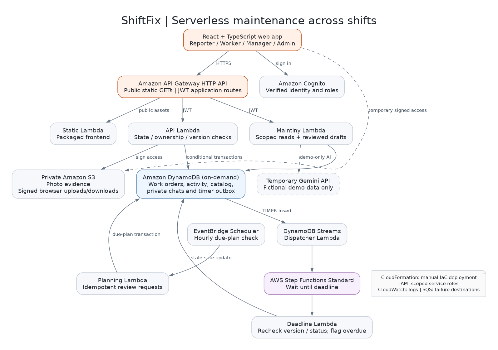

# ShiftFix

**Factory maintenance that stays owned across shifts.**

ShiftFix is a serverless factory-maintenance workspace built for the AWS Builder Center **Weekend Challenge: No Pipeline, No Problem**. It connects machine-fault reports, private photo evidence, manager review, technician ownership, durable deadlines and verified repairs.

[Live application](https://11z3m6ydfe.execute-api.ap-south-1.amazonaws.com/?release=maintiny-v20) · [Project write-up](docs/submission-body.md) · [Architecture diagram](docs/submission-assets/architecture.png) · [Operations guide](docs/operations-guide.md) · [Verification](docs/verification.md)



## The maintenance workflow

1. A **Reporter** selects equipment, describes the fault and optionally uploads photographs.
2. A **Manager** reviews, requests details, rejects with a reason, handles possible duplicates, or approves and assigns the work.
3. The assigned **Worker** accepts, records blockers or returns an incorrect assignment with an explanation.
4. The worker submits repair notes and evidence.
5. The manager verifies completion or sends the repair back for rework.

**Admins** manage account access, including Manager access. Managers manage Worker/Reporter access. Every API request rechecks the user's current verified identity and role. Editing a profile or joining a team never grants permissions.

Duplicate reports remain reviewable. Merges preserve original authors and evidence. A worker's “already repaired” claim requires a manager decision. Stale record versions are rejected, repeated submissions are idempotent, and old deadline executions cannot escalate a newer assignment or completed repair.

## Connected factory workspace

- Assets, asset types, categories, teams, locations, zones and sub-zones.
- Parts, part types, stores locations, vendors, stock adjustments, reorder levels and movement history.
- Internal purchase records with atomic, one-time stock receiving.
- Recurring preventive plans and upcoming occurrences awaiting manager review.
- Manual meter readings, threshold rules, inspection checklists and responses.
- Installed-part life tracking based on calendar service dates.
- Filterable dashboards, workload charts, CSV export, bounded asset CSV import and reversible archive controls.
- Guided onboarding, editable profiles, keyboard navigation, screen-reader feedback, high contrast, larger text and responsive layouts.

### Maintiny assistant

The **Ask Maintiny** launcher floats at the page's bottom-right, with a dismissible introduction. A dedicated workspace keeps private saved chats; both views share the current conversation. Users can start, reopen and delete conversations. Conditional writes prevent late replies from restoring deleted history.

Maintiny searches role-permitted records and prepares reviewed work-order or paused maintenance-rule drafts. Work orders require **Confirm create**; rules open in the normal editor and require an explicit save. Chat cannot grant roles, assign technicians, close repairs or adjust stock.

**Temporary provider disclosure:** Bedrock integration is implemented, but AWS account-level restrictions currently prevent model invocation. The working deployment uses **Gemini as a temporary replacement**, with tools restricted to fictional demonstration data in the selected free-tier mode. Do not enter personal or confidential information in chat. Working Bedrock inference is not claimed. See [assistant architecture, limits and data handling](docs/assistant.md).

## AWS architecture

| Service | Purpose |
| --- | --- |
| Amazon Cognito | Verified email sign-in and identity groups. |
| Amazon API Gateway HTTP API | HTTPS API and JWT-authorized application/assistant routes. |
| AWS Lambda | Python application logic, static frontend, identity setup, deadlines, stream dispatch, preventive planning and assistant tools. |
| Amazon DynamoDB on-demand | Work orders, audit activity, catalog, profiles, private chats and timer outbox. |
| DynamoDB Streams | Dispatch committed timer records. |
| Amazon S3 | Private fault/repair photographs through temporary signed access. |
| AWS Step Functions Standard | Durable deadline waits followed by current-version checks. |
| Amazon EventBridge Scheduler | Hourly preventive-plan checks. |
| Amazon SQS | Selected asynchronous failure destinations. |
| Amazon CloudWatch / AWS IAM | Operational logs and scoped runtime roles. |
| AWS CloudFormation | Infrastructure definitions and manual stack updates. |

A work-order transaction commits its state, activity and required timer record together. DynamoDB Streams invokes a dispatcher that starts a deterministic Step Functions execution. The workflow waits, then invokes a deadline checker. That checker verifies the current deadline/version/status before marking work overdue; Lambda does not remain running throughout the wait.

The initial AWS account could not create CloudFront distributions pending account verification. This prototype serves its compiled frontend through public API Gateway static GET routes and a dedicated Lambda. Application data remains JWT protected. There is no always-running application server or CI/CD pipeline to maintain.

## Try the deployed app

1. Open the [live application](https://11z3m6ydfe.execute-api.ap-south-1.amazonaws.com/?release=maintiny-v20).
2. Create an account, verify the email code, sign in and complete onboarding. New users start as Reporters unless they are the verified owner configured at deployment.
3. For a complete assignment workflow, a genuine Worker must first register and verify their account, then receive Worker access from a Manager/Admin. Only Admins can grant Manager access.
4. Use the report/review/assignment/repair/verification flow. Imported demo people are display-only and cannot sign in or receive new live assignments.

The application contains clearly labeled fictional factory history from **14 September to 14 November 2026**. Connected demo records populate the modules and charts. Seeded plans and automation rules start paused. Fictional history is not customer evidence or a measured maintenance improvement. See [demo dataset notes](docs/demo-data.md).

## Local development

Requirements: Node.js 24, npm, Python 3.11+ for local tests, and [uv](https://docs.astral.sh/uv/). Deployed Python functions use Python 3.13.

```sh
npm ci
```

Create a local, ignored `public/config.json` using the outputs of **your own** deployment:

```json
{
  "apiUrl": "https://YOUR_API_ID.execute-api.YOUR_REGION.amazonaws.com",
  "region": "YOUR_REGION",
  "clientId": "YOUR_COGNITO_CLIENT_ID",
  "userPoolId": "YOUR_COGNITO_USER_POOL_ID"
}
```

These are public application identifiers. Never put AWS credentials or model API keys in browser configuration. Local development against an AWS backend requires matching allowed origins in the infrastructure configuration.

```sh
npm run dev
```

### Build and test

```sh
npm run build
uv run --with boto3 --with 'moto[dynamodb,s3,cognitoidp]' --with pytest python -m pytest -q
node scripts/verify-resource-cache.mjs
```

The recorded backend suite has **177 passing tests**. Build, infrastructure linting and custom Guard checks pass. [Verification notes](docs/verification.md) distinguish simulated browser tests, live IAM-authorized Lambda/API checks and the remaining human multi-account validation boundary.

For the populated assistant browser suite, generate local fictional fixtures, run Vite on port5174, and execute:

```sh
python3 scripts/build-demo-data.py
npm run dev -- --port 5174
# In another terminal:
node scripts/verify-assistant.mjs
```

These browser checks use fictional API fixtures; they do not create users or write factory records. `APP_URL` can point at a deployed frontend while API responses remain intercepted fixtures. Accessibility audits run locally because production CSP blocks injected audit styles.

## Deploy your own stack

The infrastructure source is `infra/generate.py`; the generated template is `infra/template.json`.

1. Configure an authenticated AWS development session using your normal organization/account process.
2. Generate and validate the template.
3. Deploy the CloudFormation stack with `CodeBucket`, `CodeKey` and `SupervisorEmail`, acknowledging its named IAM resources. The configured owner must verify that email before receiving Admin access.
4. Fill `public/config.json` from stack outputs, build the frontend and package the backend.
5. Upload the ZIP under an unused, immutable S3 key and update the stack's `CodeKey`. Preserve the other parameters and wait for `UPDATE_COMPLETE`.

```sh
python3 infra/generate.py
npm run build
python3 scripts/package.py
```

Keep the `backend/` directory inside the ZIP: handlers use module paths such as `backend.api.handler`. The package includes the compiled frontend. Build output, runtime config, credentials and deployment artifacts are excluded from git.

Optional assistant configuration uses `AssistantProvider`, `GeminiModelId`, `GeminiDataMode`, `GeminiKeySecretArn` and `GeminiKeyVersionId`. Model keys are entered privately through `scripts/configure-gemini-secret.py` and referenced by CloudFormation through Secrets Manager dynamic references. Never commit a key or print resolved Lambda environments. See the [assistant guide](docs/assistant.md) for explicit provider setup and [deployment record](docs/deployment.md) for this prototype's history; historical identifiers are not reusable deployment configuration.

## Boundaries and costs

- This is a **single-factory prototype**, not isolated multi-tenant SaaS.
- Meter readings are manual; no live IoT sensor connection is configured. Part-life tracking uses dates rather than predictive models.
- Deadline escalation appears in the workspace; no email/SMS/push escalation is connected.
- Internal purchases do not transmit supplier orders or payments.
- Photos are limited to five JPEG/PNG/WebP files, each up to5MiB. Browser, signed-upload and backend checks enforce boundaries; image signatures are not complete malware scanning.
- Evidence attached to unresolved work is not silently deleted. Abandoned uploads and production retention need an explicit cleanup policy.
- Tokens expire; a fresh sign-in may be needed. Accessibility checks cover tested states and are not a complete certification.
- Serverless does not mean free: storage, object versions, backups, logs, scheduled checks, workflow transitions, model/provider services and key storage can incur costs. Credits are not a hard spending cap.
- Stateful resources have retention policies. Deleting the stack does not necessarily delete its data or eliminate every storage cost. Review retained resources deliberately; deployment notes record prototype cleanup considerations.

## Project documentation

- [Builder Center submission fields](docs/builder-center-fields.md)
- [Full project article](docs/submission-body.md)
- [Suggested 2:45 recording script](docs/submission-demo-script.md)
- [Operations and module behavior](docs/operations-guide.md)
- [Roles, onboarding, profiles and accessibility](docs/hierarchy-and-onboarding.md)
- [Assistant, saved chats and provider disclosure](docs/assistant.md)
- [Backend contract](backend/CONTRACT.md)
- [Validation and live-check evidence](docs/verification.md)
- [Deployment record](docs/deployment.md)
- [Factory imagery credits](docs/image-credits.md)

Factory images are illustrative, credited to YIHAI LASER / Pexels, and do not represent customer repairs. See the image credits for source and license links.
