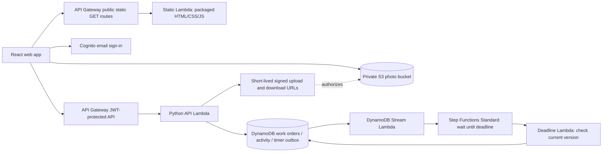

# ShiftFix

A serverless factory-maintenance prototype: from a machine-fault photo to an owned task, an auditable decision, and a supervisor-verified repair.

## What it does

- Operators report faults on a small Plant 01 machine registry with descriptions, priority, categories and optional private photo evidence.
- Supervisors approve and assign requests, ask for details, reject with a reason, merge duplicate reports, or explicitly keep similar reports separate.
- Technicians accept their current assignments, mark a repair blocked, return an incorrect assignment with a reason, and submit repair notes/photos.
- Supervisors accept a completed repair or send it back for rework. A returned assignment claimed to be already repaired can be closed only by a supervisor with a recorded explanation.
- Reporters can resubmit a request after clarification. Closed/rejected work can have linked follow-up reports.
- A timeline preserves who did what and why. Merged reports retain their original authors and evidence.
- Step Functions waits for versioned deadlines, then rechecks current state before flagging an overdue job. Reassignment, closure, and deadline changes make old timers harmless.
- Supervisors can promote verified users to technicians from Overview → Team access.

## Architecture



The account initially blocked CloudFront creation pending AWS account verification. The deployed approach therefore serves the compiled frontend through public API Gateway GET routes and a static Lambda. The data API remains JWT protected. This is a small demonstration hosting approach, not a CDN replacement. Lambda, API Gateway, DynamoDB, S3 and Step Functions all participate in the working architecture; there is no deployment pipeline or always-running server.

## First use

1. Open https://11z3m6ydfe.execute-api.ap-south-1.amazonaws.com .
2. Choose **Create an account**. Use the configured supervisor email to claim supervisor access. Other verified accounts start as operators.
3. Confirm the email code and sign in. Passwords are handled by Cognito; they are not placed in source or deployment configuration.
4. A technician must first sign up and verify their own email. The supervisor can then promote them under **Overview → Team access**. Sign out and sign in after a role change to obtain a fresh token.
5. Report a fault, approve/assign it, and walk through technician acceptance, repair submission, and supervisor verification.

The configured supervisor email is deployment configuration, not a publicly editable role field. The post-confirmation trigger grants supervisor access only after the matching email has been verified.

## Local development

Requirements: Node.js 24, npm, Python 3.11+ for local tests, and `uv`. Lambda runtime is Python 3.13.

```sh
npm ci
npm run dev
```

The frontend fetches `/config.json` with `{ "apiUrl": "https://...", "region": "ap-south-1", "clientId": "...", "userPoolId": "..." }`. Use real stack outputs in `public/config.json` for local work. These are public identifiers, not AWS access keys. The deployed static bundle includes its runtime config. No cloud credentials belong in the browser.

```sh
npm run build
uv run --with boto3 --with 'moto[dynamodb,s3]' --with pytest python -m pytest -q tests
```

Backend interfaces and exact request shapes: [backend/CONTRACT.md](backend/CONTRACT.md).

## Infrastructure and deployment

`infra/generate.py` generates `infra/template.json`. The template creates the API, Cognito pool/groups, Lambdas and scoped service roles, encrypted DynamoDB with point-in-time recovery, private encrypted S3 evidence bucket, deadline state machine, stream mapping and failure queue, and short-retention logs.

The template parameters are `CodeBucket`, `CodeKey`, and `SupervisorEmail`. Package the backend **without flattening its directory**: handlers use `backend.api.handler`, `backend.auth.post_confirmation`, `backend.deadlines.stream_handler`, `backend.deadlines.expire_handler`, and `backend.static.handler`. The compiled frontend and runtime config belong in `backend/staticfiles/` for static hosting.

Deploy by creating/updating a CloudFormation stack through the AWS MCP server or CloudFormation console, supplying the package bucket/key and acknowledging the named IAM resources. This repository does not run a CI/CD pipeline. Regenerate the template before deployment so the source and generated artifact agree.

Normal deadlines are one hour to acknowledge, four hours for repair, and two hours for verification. Set `ACK_SECONDS`, `REPAIR_SECONDS`, and `VERIFY_SECONDS` in the API Lambda configuration/template for a deliberately shortened recorded demonstration. Do not claim those shortened values are production policy.

## Data and security boundaries

The API checks verified email claims, role, record visibility, current assignee, allowed state, and optimistic version. A technician cannot mutate another technician's job. Duplicate detection is a machine/category suggestion, not image recognition or an automatic merge. Every state-changing decision writes an activity entry in the same DynamoDB transaction. Photo uploads are limited to five JPEG/PNG/WebP files of at most 5 MiB per batch, signed briefly, and validated before attachment. Evidence is not automatically deleted from open work orders.

## Limits and costs

This is a one-factory hackathon prototype with a fixed machine registry, modest-traffic list queries, and an inbox-based escalation flag. It has no email/SMS/push escalation, spare-parts inventory, offline mode, shift-calendar scheduling, or production multi-tenant boundaries. File-type checks use declared content type and object metadata, not malware scanning. Photo URLs are temporary. User sessions require fresh sign-in when tokens expire. Abandoned uploads and evidence retention need an explicit cleanup policy before production.

The account was observed on an active **Paid plan with USD 100 credits**, not the Free Plan. Credits are not a hard spending limit. API throttles and short log retention reduce risk but do not guarantee a zero bill. S3 versions, DynamoDB backups, logs, workflow transitions and API/Lambda usage can incur costs.

## Cleanup

Review and delete the active application stack when finished, after saving needed evidence. S3 evidence, DynamoDB, and Cognito resources use retention policies: stack deletion alone does **not** remove all data or associated storage costs. Inspect stack resources and retained resources before any manual deletion.

An earlier failed stack retained these resources, which must be accounted for separately:

- DynamoDB table `shiftfix-Table-1WAZJDQCIA0HH`
- S3 bucket `shiftfix-web-ehvp8oztsmip`

Do not delete them automatically. S3 versioning means cleanup must handle prior versions and delete markers explicitly. Also inspect the deployment package bucket, logs and failure queue. Keep a record of what is retained before confirming cleanup.

See [verification notes](docs/verification.md) and [submission draft](docs/submission.md).

Final verification: 31 backend tests pass; production build and cfn-lint pass; live storage/evidence/deadline integration verified with synthetic QA data. Owner email sign-up and full browser repair flow still pending.
