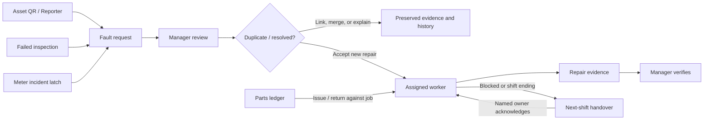

# ShiftFix: final-day feature and reliability plan

Date: 2026-11-14. Planning budget: one remaining 24-hour window, as requested. Time estimates are judgment calls for someone already familiar with this code, not delivery guarantees. Research and audit are complete; the proposed fixes/features below have not been deployed. Live remains v9 with the fictional-data disclosure.

## The recommended product story

A factory operator identifies the machine, reports a fault or fails an inspection, and a supervisor decides what happens next. The worker sees the repair instructions and available spares, records the parts used and repair evidence, and the manager verifies completion. Anything unfinished becomes an explicit, acknowledged handover to the next shift.

That story connects the existing assets, inspections, work orders, inventory, schedules and audit history. It gives the three-minute demo a clear problem, visible exceptions and a reusable serverless pattern. A broad catalog already exists; the greatest next value is in these connections.

## Research package

- [CMMS feature comparison](2026-11-14-cmms-feature-research.md): 21 workflows, first-party sources, 49 proposed factory acceptance examples, and a larger backlog. Vendor behavior is distinguished from our recommended contracts.
- [Code/runtime audit](2026-11-14-code-and-runtime-audit.md): 9 backend probe observations plus a UI response-order race, alongside inspected implementation gaps and the live deployment evidence.
- [100-case test matrix](2026-11-14-edgecase-matrix.csv): scenario, expected behavior, P0/P1/P2 priority, existing/proposed/reproduced status, and evidence. Existing safeguards are explicitly retained rather than counted as missing features.
- Raw local evidence:[backend probes](2026-11-14-edgecase-probe-results.json), [UI race](2026-11-14-ui-race-probe.json).

P0 means unauthorized access or incorrect irreversible business state must block release. P1 means a high-value workflow or important reliability repair for this final day. P2 means polish, scale or extended behavior that can be deferred. The current matrix includes both already-protected P0 cases and proposed contracts for features not yet present. It is not a report of 100 existing defects.

## Build order and scope

| Order | Deliverable | What makes it real | Estimated effort |
| --- | --- | --- | --- |
| 1 | Stable report/draft command and safe evidence retries | A lost response or failed third upload can be retried without creating another report, losing text, or hashing a new upload into a conflicting request. Show saved locally / uploading / committed / needs reconciliation. | 1.5–2.5h |
| 2 | Evidence integrity and latest-selection UI guard | Reject undecodable images, cap decoded pixels, bind evidence to a validated S3 version/checksum, and prevent a slow earlier detail response replacing a later selection. | 1.5–3h |
| 3 | Meter incident suppression and strong duplicate candidates | Distinct readings update one unresolved incident according to an explicit per-rule policy; clear/re-cross behavior is defined. Existing same-asset work is discovered through authoritative references. | 1–2h |
| 4 | Parts issue/return inside the work-order detail | Current authorized worker/manager issues quantity against a job; transaction updates stock, job ledger and audit together. A return reverses a specific prior issue and cannot over-return. | 2–3h |
| 5 | Failed inspection → corrective review request | A Fail answer with context creates or links one review request with response/template/question provenance. Retrying cannot generate a second follow-up. | 1–2h |
| 6 | Shift handover with carryover and acknowledgment | Filter by shift/team/location; show current unresolved work even when created earlier, blockers, required part and next owner. Acknowledgment records a receipt, not completion. | 1.5–2.5h |
| 7 | Asset deep links / printable QR labels | Scanning a code opens the exact machine and preselects it after authenticated sign-in. No public mutation or sensitive data in the QR. | 0.5–1h |
| 8 | Reporting clarity | Real-only/demo-only/all scope, clear created-vs-completed date meaning, daily trend and clickable source work. No invented MTBF/MTTR. | 0.5–1h |

These estimates can exceed the available day once verification and submission are included. Treat1–6 as a ranked sequence with stopping points. Start each feature only after the prior slice is usable and tested. If we fall behind, retain the integrity fixes and job-linked parts/inspection flow, then keep handover as a read-only summary. QR and visual trend are the first cuts; reservations, full offline and extra services are outside the critical path.

### A concrete 24-hour budget

- Hours0–4: reliability fixes and foundational operation IDs; at minimum fix the photo response-loss path, immutable evidence references, meter storm contract and stale detail selection. If bounded image decode packaging takes longer, reduce optional scope rather than silently claiming validation.
- Hours4–7: job-linked part issue/return, normalized SKU/unit rules, ledger views and concurrency tests.
- Hours7–9: inspection corrective action and historical template snapshots/restore behavior.
- Hours9–11: handover summary, carryover and named acknowledgment; simple in-app unread state only if it fits the existing event flow.
- Hours11–12: QR deep links and demo/data-scope reporting only if the core is stable.
- Hours12–16: real Reporter→Manager→Worker browser path, role changes, duplicate/collision/timeout tests, mobile and keyboard use. Fix the failures found here before adding anything else.
- Hours16–19: write-up, architecture diagram, original-project source notes and public video under three minutes, following the supplied hackathon rules.
- Hours19–24: deployment verification, submission checks and buffer. Preserve the current working immutable release as rollback reference.

These are planning buckets, not a promise to implement every upper-bound estimate. A feature that cannot pass its core acceptance tests stays out of the final submission claims.

## Smallest useful contracts for the new features

### A. Durable commands and evidence

A client generates an operation ID once, persists it with the user-scoped draft and reuses it until the outcome is known. The server records operation ID, normalized payload hash and result in the same transaction as the business change. A replay returns the prior result; a genuinely changed body under that ID is a conflict. DynamoDB's request-level replay mechanism has a finite window, so the product's durable command record must cover the intended user retry horizon. [AWS transaction request identity](https://docs.aws.amazon.com/amazondynamodb/latest/APIReference/API_TransactWriteItems.html).

Upload identities belong to that draft. Keep completed upload results when another file fails; reconcile before minting replacements. Validate the exact object version that is committed and issue links for that same version. Use the existing count/byte/type checks plus bounded image decode, and keep temporary upload cleanup separate from retained evidence. [OWASP layered upload controls](https://cheatsheetseries.owasp.org/cheatsheets/File_Upload_Cheat_Sheet.html), [AWS presigned-request behavior](https://docs.aws.amazon.com/AmazonS3/latest/userguide/using-presigned-url.html).

### B. Parts usage

Suggested extension: `POST /workorders/{id}/parts/issue` and `/return`, each with stable operation ID and relevant record version(s). An issue writes stock balance, immutable movement, job association and work activity atomically. The ledger snapshots quantity/unit and cost/currency if supplied; unavailable cost is unknown, not a fake zero. The current role check must be repeated at commit authorization. A job's closure/merge/archive policy must define what happens to allocated or issued parts.

For this day, implement physical issue and bounded return first. If reservations are later added, `available=onHand-reserved`; reserving does not reduce physical stock and issue cannot decrement both balances twice. Established CMMS tools distinguish committed inventory from issued stock, which is why these should not be one ambiguous field. [MaintainX part availability](https://help.getmaintainx.com/part-statuses-and-part-availability).

### C. Inspection corrective action

Suggested extension: `POST /catalog/inspection_responses/{id}/corrective-request`. Store the executed template version, immutable question/answer snapshot and one follow-up link. The transaction checks asset state, role, response identity and existing link. The manager still chooses merge/separate/already-resolved; a failed inspection must not silently complete or auto-authorize maintenance. MaintainX documents corrective-work prompts from failed inspection fields; our exact linking/deduplication contract is a proposed design. [MaintainX corrective action](https://help.getmaintainx.com/trigger-a-work-order).

### D. Shift handover

Use deterministic source records, not an AI summary, for this release. Suggested fields: shift start/end in explicit plant timezone, scope/team, source job IDs and versions, blockers, next action/owner, author, publishedAt and acknowledgment actor/time. Separate changes during the shift from unresolved carryover. Acknowledging a snapshot does not approve a repair. A changed source should show “updated since handover,” with a link to the current job. Vendor shift summaries reinforce the usefulness of time/team scope; our carryover/acknowledgment is an additional design choice. [MaintainX end-of-shift summary](https://help.getmaintainx.com/end-of-shift-summary).

### E. Meter incident state

Store a durable incident link per rule/asset/condition and update it transactionally with the reading. Distinguish exact command replay, a new reading while the fault persists, and a new condition after recovery. Define explicit behavior for rejected/merged/closed incidents, concurrent readings, disabling rules and threshold changes. A visible suppressed action should point to its current incident. Established automation tools expose retrigger/open-work-order suppression and action history. [MaintainX automation behavior](https://help.getmaintainx.com/faq-automations).

## Factory scenarios for the final demo

1. Scan/open the hydraulic press. Submit a report or record a failed inspection with a clearly labeled example photo.
2. Supervisor sees a potentially related request and chooses to link it or keep it separate with a reason. Show the decision in history.
3. Assign a real Worker account. The wrong worker cannot accept; the assigned worker sees the repair and available spare.
4. Issue one spare, then replay the same command to show stock did not decrement twice. Show a bounded return or insufficient-stock rejection.
5. Block the job while waiting for a part, publish the next action into handover, and acknowledge it as the next responsible person.
6. Submit evidence, verify as Manager, and show the linked inspection, stock movement and handover references retained in the final history.

A three-minute recording cannot demonstrate all six scenarios in depth. Prefer one continuous story with one duplicate/retry failure and one permission check; use screenshots/write-up for the rest. Existing fictional users are not credentials or real Worker accounts. A human needs to register/verify the real accounts used for the multi-user browser demonstration; do not fabricate identity verification.

## Stretch features, in order after the core passes

- Lightweight manual labor entries and failure/cause/remedy codes, then job cost snapshots.
- Explicit downtime episodes, with planned/unplanned classification and non-overlapping asset intervals.
- In-app notification inbox and operator failure panel backed by durable events; no unrequested external messages.
- Spare reservations and parts-ready status, then partial receipt/reversal and cycle counts.
- Persistent offline text drafts; attachment drafts and offline stock execution require more reconciliation work.
- Fixed versus verified-completion-based PM, then timezone-aware calendar/usage schedules and meter resets.
- Saved filters, CSV export jobs, print-friendly work-order/asset sheets and accessible chart data tables.
- Attach approved asset manuals and SOP links; keep hazardous-work authorization within the factory's actual process.

## Keep out of this final-day critical path

Full offline mutation synchronization, true multi-site authorization, IoT integrations without devices, public anonymous portals, supplier payment/invoice automation, drag-and-drop workflow builders, predictive failure claims and broad AI image diagnosis. Each adds a new trust or correctness boundary that the current feature breadth does not resolve. They belong in a clearly labeled future roadmap.

MTTR and MTBF require failure/outage/runtime definitions and data; work-order request/closure timestamps alone are insufficient for the desired reliability interpretation. Use observed workflow metrics now, then collect the right measurements. [IBM reliability metrics](https://www.ibm.com/think/topics/mttr-vs-mtbf).

## Verification and release gates

- Preserve existing role, image ownership, stock, version, reference/archive and timer safeguards. Add cases for new command and ledger paths; do not just mirror implementation branches.
- Real-account browser path: Reporter onboarding→report→Manager decision→Worker return/accept/repair→Manager verify. Include demotion, stale tab, unauthorized direct endpoint and expired-session recovery. Fixture tests remain useful but are not a substitute for this path.
- Fault injection: lost response after commit, two simultaneous requests, stale GSI, expired upload, partially completed transfer, one poisoned schedule and delayed UI responses. Run against isolated stores first.
- Operational visibility: distinguish configured schedule, last attempted run, last business success, skipped/quarantined work, failed workflow and DLQ backlog. A successful Lambda invocation must not hide skipped business failures.
- Reports and screenshots visibly identify fictional data. Separate demo work from real operations where metrics are compared.
- Confirm completed deployment and invoked code hashes, public bundle, authenticated API behavior and a targeted live transaction after every production release. Keep credentials and authentication codes out of research notes and recordings.
- Finish and verify the written Builder Center project, service connections and the less-than-three-minute public demo link required by the supplied rules. The research does not replace those deliverables.

Decision: maximize complete, explainable factory workflows and tested recovery. The concrete next implementation sequence is integrity/retries → job-linked parts → inspection follow-up → handover, followed by the low-risk QR/reporting additions if time permits.
